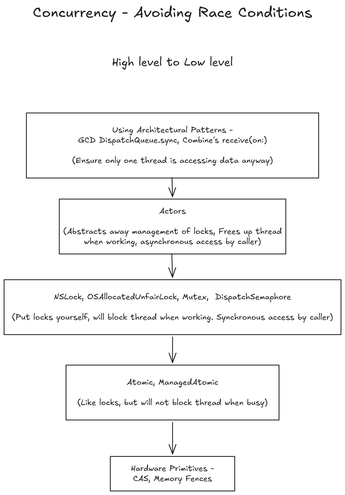
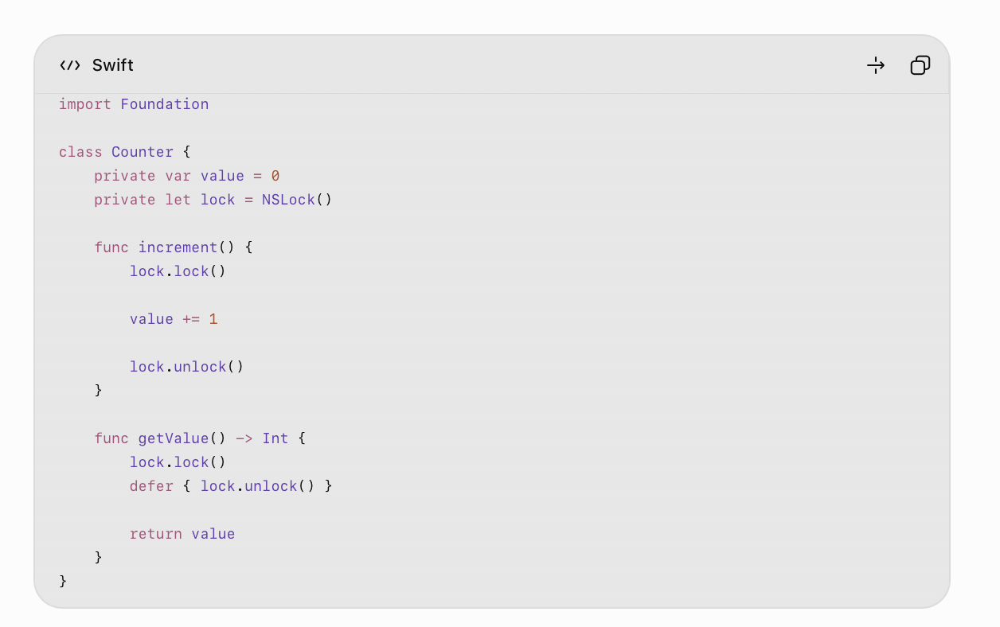
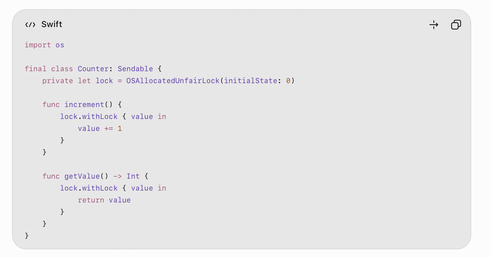
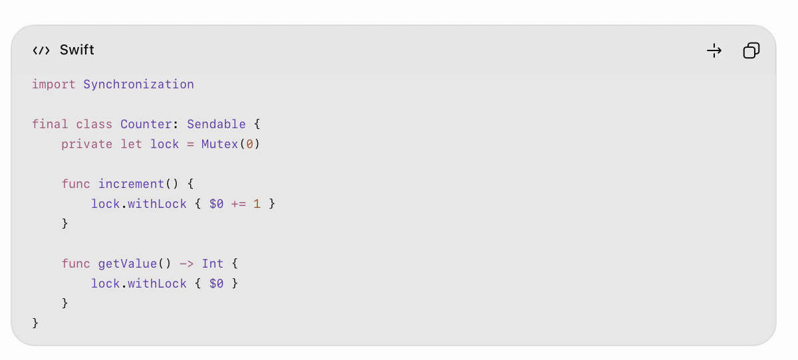
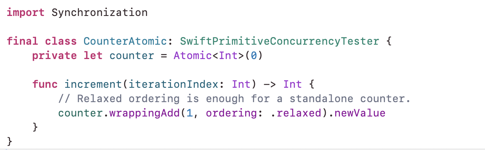
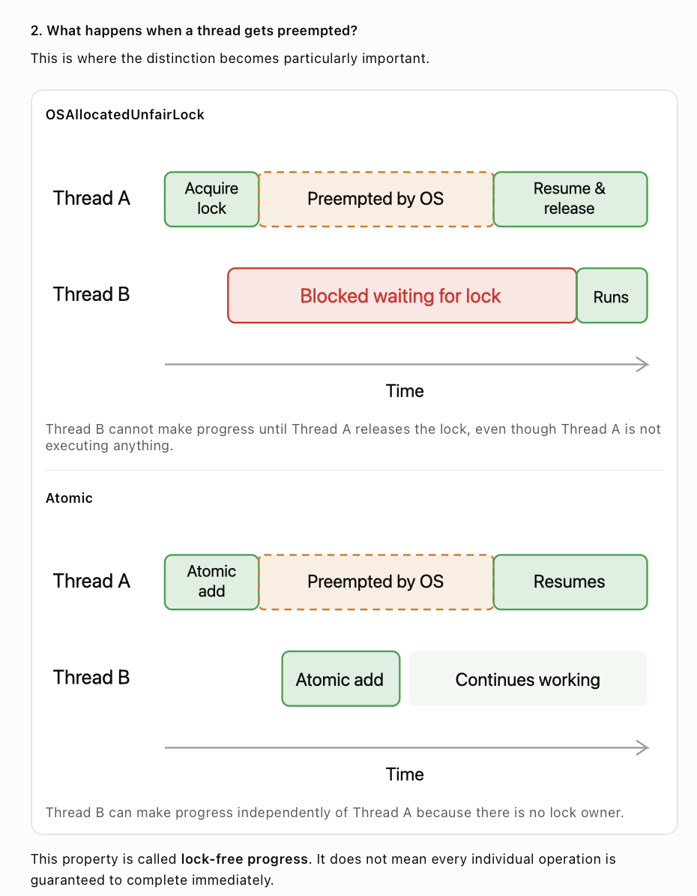

[toc]

##### What is a Race Condition after all

As for what a **race condition** even is, its shown well in this [YouTube video](https://www.youtube.com/watch?v=MqnpIwN7dz0).   Basically, if there is mutable memory somewhere then with no other checks in place its always possible that  1. Two different things/threads access it with the intent to modify it in relation to what it previously had (say increment)  2. The way increments work are that you first have to read what is there and then just overwrite with a new value that you ascertain  3. If both the things happen to attempt a read at about the same time (i.e. second thing reads even before first thing has done its write), then both the things will end up overwriting the same value onto the memory. And that will be incorrect, because the expectation is that the memory is incremented by as much as the number of things accessing it (whereas with this, it will be something lesser).

##### Various ways to handle race conditions

Queue based isolation (i.e. force things to eventually happen in a single queue) > Swift Concurrency (i.e. use actor, etc.) > Locks (OSAllocatedUnfairLock, NSLock, etc.) > Atomics (Atomic, stdatomic.h, etc.) > Hardware memory barriers

##### Locks and Mutex

👉 The main USP for locks/mutex is that they do not require await able/asynchronous code at callsite. But it doesn't mean they will not block the thread while they do their work.

The basic code is simple. The classic way is to use **NSLock**, a more modern way is to use **OSAllocatedUnfairLock**. In the former, there need to be separate properties for lock and the actual state and you will need to ensure yourself that the state access is always encapsulated in the lock. In the latter, it happens automatically as the state is a part of the lock itself.

> The reason it is called **OSAllocatedUnfairLock** is that waiting threads are not guaranteed to acquire the lock in the order in which they requested it. This unfairness can improve performance by allowing more efficient thread scheduling.

| Basic NSLock usage                                           | Basic OSAllocatedUnfairLock usage                            |
| ------------------------------------------------------------ | ------------------------------------------------------------ |
|  |  |

**Mutex** (~Mutual Exclusion Lock) is very much like OSAllocatedUnfairLock, and the only real difference between them is how they internally implement copying, i.e. what happens when `lock1=lock2` is done (explained more in [this chat](https://chatgpt.com/g/g-p-6ac2945a87ac8191a082fb0f1740a11c-ios-concurrency/c/6b0636ae-751c-83ea-a30e-438eb63a2178)). UnfairLock can allow underlying state to be copied and mutated from outside but Mutex does not and is hence safer. And it probably also does better checks if its state is a non-Sendable.

**Atomic** is even more low level, its API is similar. 

Its USP however is that like Swift Concurrency tasks, it can free up the thread for other things while the atomic does its work (that is not something that locks and mutex allow). The term for this thing is **lock-free progress**.

##### Resources

Race condition handling mechanisms  ([ChatGPT link](https://chatgpt.com/g/g-p-6ac2945a87ac8191a082fb0f1740a11c-ios-concurrency/c/6b05e693-33b8-83ea-8f6c-151fbf6e159f))  Locks and Mutex ([ChatGPT link](https://chatgpt.com/g/g-p-6ac2945a87ac8191a082fb0f1740a11c-ios-concurrency/c/6b0636ae-751c-83ea-a30e-438eb63a2178))  Atomic  ([ChatGPT link](https://chatgpt.com/g/g-p-6ac2945a87ac8191a082fb0f1740a11c-ios-concurrency/c/6b085150-2694-83ea-a64a-5d28ca2e3bcb))

Sample code - `TestConcurrency/ViewController.swift - testSwiftPrimitives_UnderPossibleRaceCondition()`