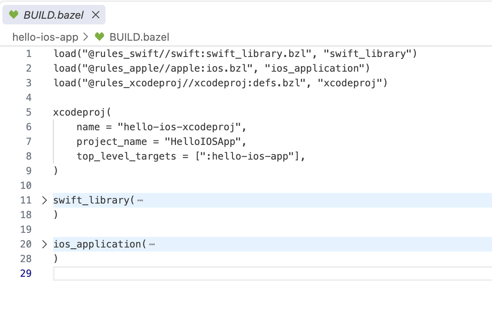
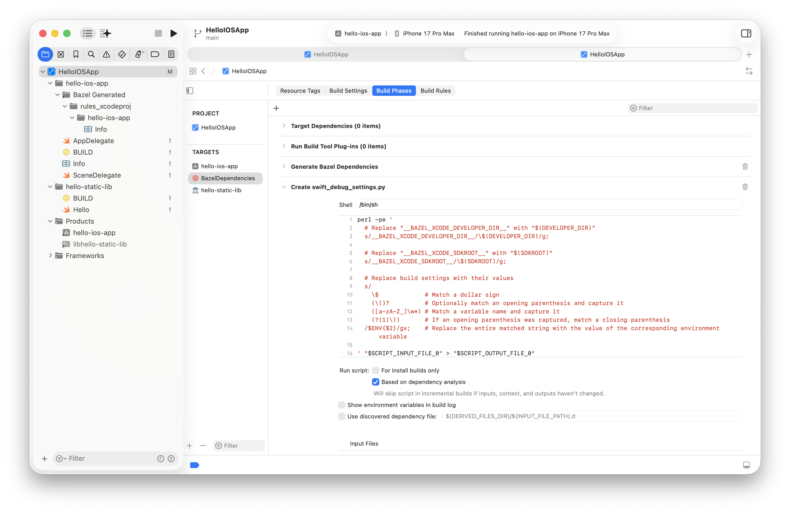
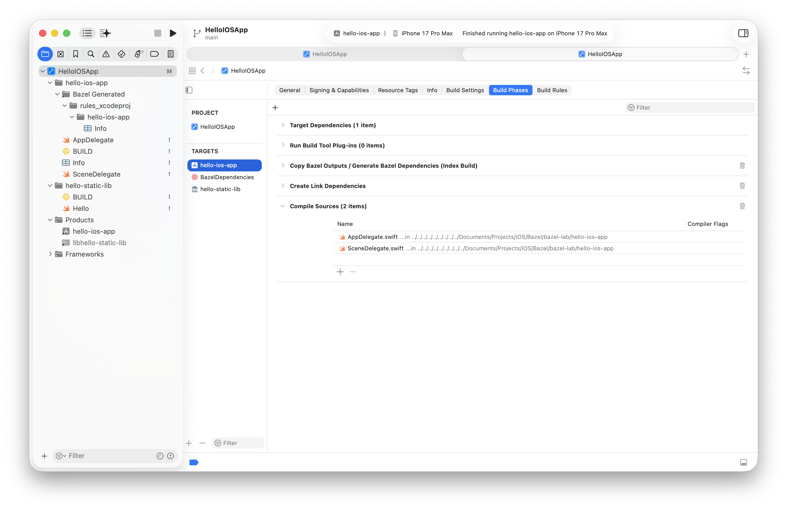

##### Generating the project

Its basically running a particular rule target.

```
bazel run //hello-ios-app:hello-ios-xcodeproj
```



##### What does the created project look like

It does some very funky things. Creates an Aggregate Target, that Aggregate Target has just ~2 things, one script to generate dependencies and another to set up LLDB.



Then the actual app has this Aggregate Target as its Target Dependency, followed by a series of Build Phase scripts that copy the artiifacts generated by that Target Dependency, do linking, and compile some files that are directly included.



Any static lib that you have does get a target of its own too, but the only practical utility of that target is to have a scheme that you can then run yourself if you wantrd to. When the real app is run, that static lib target may as well be removed.

##### Misc.

Codex explanation link ([link](codex://threads/01a0ea95-2e96-7123-a2e4-25bc0d9bd2d0))