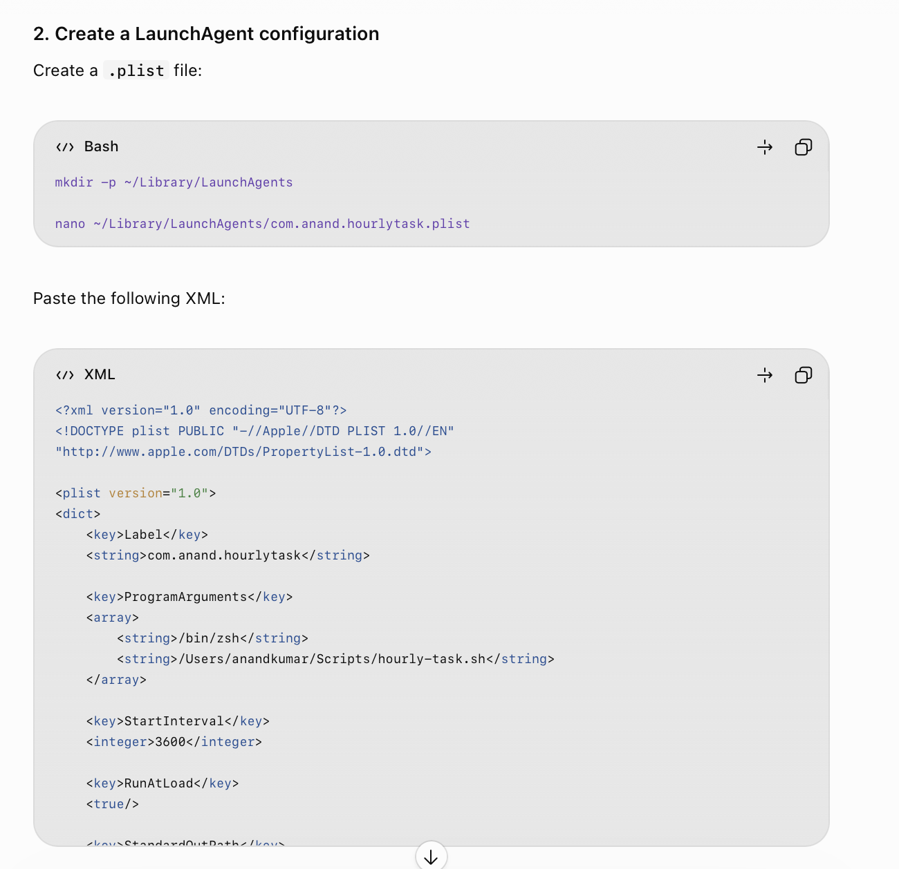
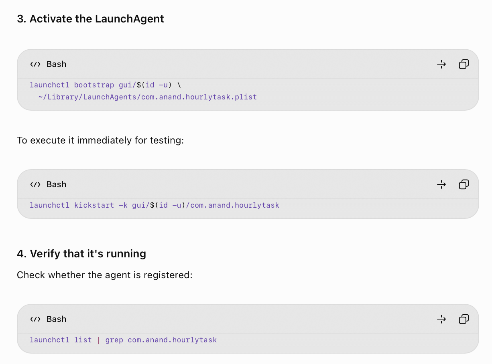
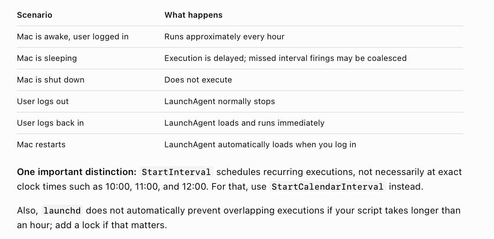
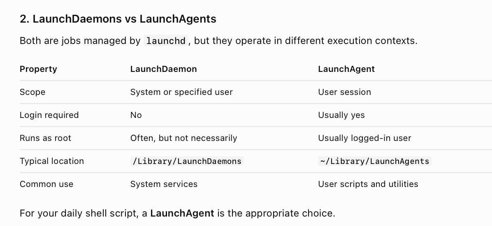

#### launchd - Scheduling script runs

##### Basics - How to use it

Its what you use to schedule automatic running of shell scripts. Its like **systemd** of Linux. The config (i.e. the script it runs, how often it is run, etc.) needs to be out in a new plist  file, and that plist then added to bootstrapping process using **launchctl**. (To remove it, use launchctl again).

| 1. Create plist                                              | 2. Add to LaunchAgent                                        |
| ------------------------------------------------------------ | ------------------------------------------------------------ |
|  |  |

##### What is it technically

It is responsible for starting, scheduling, monitoring, and managing background processes. After system booting, the kernel starts **launchd** as the first user-space process (with PID 1). **launchctl** is the command-line interface for interacting with **launchd**.

 

##### Resources

[ChatGPT link](https://chatgpt.com/c/6b030acf-ef98-83e8-b7b3-aa6079750b8f)